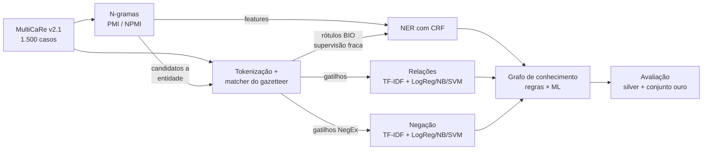
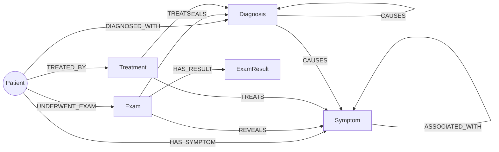
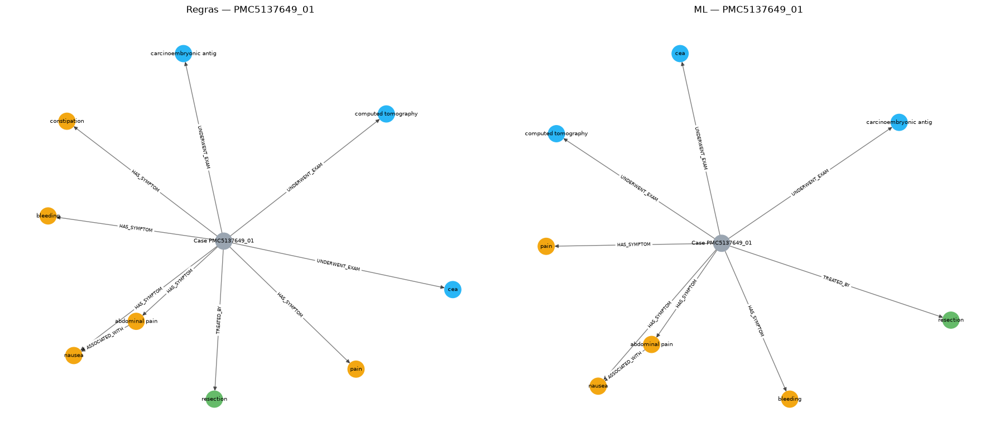

# Projeto `Do Relato Clínico ao Grafo: N-gramas e Aprendizado de Máquina`

## Slides

PDF da apresentação encontra-se em: [assets/slides/MC896-Projeto-2](assets/slides/MC896-Projeto-2).

## Demonstração Executável

- **Notebook completo:** [`pipelines/notebooks/notebook_projeto2.ipynb`](pipelines/notebooks/notebook_projeto2.ipynb). As instruções de execução estão em [`src/README.md`](src/README.md).

## Metodologia

No Projeto 1, o grafo era extraído só com regras: um gazetteer (lista de termos) e expressões regulares. Neste projeto investigamos se **métodos estatísticos e de aprendizado de máquina**, treinados a partir dos próprios textos, conseguem superar ou complementar essas regras. Seguimos a restrição da disciplina: nenhum LLM, Transformer ou embedding pré-treinado é usado na extração.

A ideia central é a **supervisão fraca** (*weak supervision*). As regras do Projeto 1 rotulam automaticamente milhares de sentenças, e os modelos aprendem com esses rótulos. Depois, um **conjunto ouro** anotado manualmente mede se o modelo aprendido erra menos que as regras que o "ensinaram".



### 1. Dados

Usamos os 56 casos clínicos fornecidos. Sorteamos 25% dos casos e dividimos em treino (45) e teste (11) **por artigo**, para que casos do mesmo artigo não fiquem nos dois lados.

### 2. Pré-processamento e matcher

Corrigimos três problemas do Projeto 1:

- **Casamento por frase inteira.** O matcher agora busca o maior termo possível, por sequência de *stems*. No Projeto 1 cada palavra de um termo composto era indexada sozinha, e por isso "of" virava "loss of appetite".
- **Tokenização.** Hífens e alfanuméricos são preservados (`x-ray`, `pd-l1`, `hba1c`).
- **Processamento em lote.** Todos os casos são processados, com IDs determinísticos para os nós.

### 3. Análise de N-gramas (PMI / NPMI)

Calculamos bigramas e trigramas no treino, ignorando stop-words, e medimos a associação entre as palavras:

$$\mathrm{PMI}(x,y)=\log_2\frac{P(x,y)}{P(x)\,P(y)}\qquad \mathrm{NPMI}(x,y)=\frac{\mathrm{PMI}(x,y)}{-\log_2 P(x,y)}\in[-1,1]$$

O NPMI corrige o viés do PMI a favor de pares raros. Os n-gramas são usados de três formas:

1. **Candidatos a entidade nova:** colocações fora do gazetteer, com tipo sugerido pelo sufixo (`-itis` sugere diagnóstico, `-scopy` sugere exame).
2. **Features do CRF:** indicador de que o bigrama vizinho tem NPMI alto.
3. **Features dos classificadores de relação e de negação:** TF-IDF de 1 a 3-gramas.

### 4. Reconhecimento de entidades (NER) com CRF

O NER é tratado como etiquetagem de sequência no formato BIO (`B-Diagnosis`, `I-Diagnosis`, `O`…), com rótulos gerados pelo gazetteer. As features são a palavra, o stem, prefixos/sufixos, a forma ortográfica e uma janela de ±2 palavras. Numa **ablação**, acrescentamos bigramas, trigramas e o indicador de PMI.

**Experimento de generalização:** escondemos 25% dos termos do gazetteer (65 termos) no treino e medimos se o CRF os encontra no teste. As sentenças com termos escondidos saem do treino; se ficassem, o modelo aprenderia que esses termos são `O`.

### 5. Relações entre entidades

Para cada par de entidades vizinhas na mesma sentença, um classificador decide a relação: `REVEALS` (exame revela condição), `TREATS`, `CAUSES`/`CAUSED_BY`, `ASSOCIATED_WITH` ou `NONE`. Os rótulos de treino vêm de gatilhos (`secondary to`, `treated with`, `showed`…). As features são o TF-IDF de n-gramas do trecho entre as entidades e das janelas ao redor, os tipos das entidades e a distância entre elas. Comparamos Regressão Logística, ComplementNB e LinearSVC, com n-gramas de tamanho 1, 2 e 3.

### 7. Grafo e avaliação

Construímos dois grafos sobre os casos de teste:

- **Regras:** gazetteer + gatilhos;
- **ML:** CRF + classificadores.

Os dois são avaliados de duas formas:

- **Silver:** concordância com os rótulos das regras.
- **Ouro:** A amostra é estratificada e inclui os casos em que regras e ML discordam.

### Confronto com Trabalho Anterior

| Aspecto | Projeto 1 | Projeto 2 |
|---|---|---|
| Casamento de entidades | Palavra a palavra, com falsos positivos ("of" → *loss of appetite*) | Frase inteira, pelo maior casamento |
| Escala | 1 caso processado, base de 56 casos | 56 casos do, treino/teste por artigo |
| Termos novos | Só o gazetteer fixo | PMI propõe 5 candidatos; o CRF reconhece termos fora do gazetteer |
| Forma do grafo | Estrela: paciente → entidade | Também relações entre entidades
| Avaliação | Qualitativa | P/R/F1 silver, ablação de n-gramas, conjunto ouro, métricas de grafo |


<!-- TODO imagem: comparação lado a lado do grafo de um caso no P1 e no P2 -->

## Trabalhos Estudados

- **CRF** (Lafferty et al., 2001): modelo de etiquetagem de sequências usado como base clássica para NER.
- **PMI** (Church & Hanks, 1990) e **NPMI** (Bouma, 2009): medidas de associação para descobrir colocações.
- **Supervisão fraca** (Ratner et al., 2017, Snorkel): usar regras para rotular dados de treino automaticamente.

## Modelo Lógico

<!-- TODO imagem: PNG do modelo lógico em assets/images/ -->



- Os **nós de entidade** são compartilhados entre pacientes (id = `tipo:stems`), o que permite análises no nível do corpus.
- As **arestas entre entidades** guardam `count` (número de menções) e `n_cases` (número de casos).
- O **paciente** guarda idade e sexo.
- Os **resultados de exame** (`ExamResult`) guardam valor e unidade.

## Análises que podem ser realizadas

- **Perfil de cada caso:** o grafo resume sintomas, exames, diagnósticos e tratamentos. Essa separação é útil no diagnóstico diferencial.
- **Associações no corpus:** com os nós compartilhados, dá para contar quais exames mais revelam um diagnóstico, quais tratamentos aparecem para cada condição e quais sintomas costumam vir juntos.
- **Comparação de extratores:** a diferença entre o grafo das regras e o do ML aponta onde cada método falha. Essa é a visão "Diferença" da página.
- **Expansão de vocabulário:** os candidatos de PMI e as entidades propostas pelo CRF fora do gazetteer indicam termos para incorporar.

## Ferramentas

- **pandas / pyarrow:** leitura do MultiCaRe (parquet aninhado) e manipulação das tabelas.
- **re:** tokenização, gatilhos de relação e de negação, e extração de valores de exames.
- **sklearn-crfsuite:** CRF para o NER. É leve, roda em CPU e aceita features em dicionário, o que facilita a ablação de n-gramas.
- **scikit-learn:** TF-IDF de n-gramas, Regressão Logística, ComplementNB, LinearSVC e métricas.
- **networkx / matplotlib:** métricas estruturais e figuras do grafo dentro do notebook.

## Resultados

### NER: CRF × regras (F1 silver)

| Modelo | F1 (56 casos) | 
|---|---|
| Regras (léxico reduzido) | 0,92 | 
| CRF uni | 0,67 |
| CRF uni+bi | 0,66 |
| CRF uni+bi+tri | 0,65 |
| CRF uni+bi+tri+PMI | 0,65 |

- **Os n-gramas como feature não melhoraram o CRF.** A janela de ±2 palavras já captura o contexto local.

### Relações 
```
--- rule vs ouro (n=51) ---
                 precision    recall  f1-score   support

ASSOCIATED_WITH      1.000     1.000     1.000         1
         CAUSES      1.000     1.000     1.000         1
           NONE      0.958     0.979     0.968        47
        REVEALS      0.000     0.000     0.000         1
         TREATS      0.000     0.000     0.000         1

       accuracy                          0.941        51
      macro avg      0.592     0.596     0.594        51
   weighted avg      0.922     0.941     0.932        51

--- ml vs ouro (n=51) ---
                 precision    recall  f1-score   support

ASSOCIATED_WITH      0.500     1.000     0.667         1
         CAUSES      0.000     0.000     0.000         1
           NONE      0.979     0.979     0.979        47
        REVEALS      0.000     0.000     0.000         1
         TREATS      1.000     1.000     1.000         1

       accuracy                          0.941        51
      macro avg      0.496     0.596     0.529        51
   weighted avg      0.931     0.941     0.935        51
```

- **As regras são mais precisas; o ML tem mais recall.**
- **O ML supera as regras em TREATS** porque aprendeu construções que nenhum gatilho cobria: *"diabetes **on** insulin therapy"*, *"rehabilitation **because of** stroke"*, *"chemotherapy was able to **suppress** tumor progression"*.
- A classe CAUSES não tem exemplos no ouro, o que distorce o macro-F1.

**Padrões aprendidos.** Os maiores pesos da regressão logística redescobrem os gatilhos, sem que precisem ser programados:

| Relação | Padrões |
|---|---|
| CAUSED_BY | `due to`, `secondary to`, `because of` |
| REVEALS | `showed`, `revealed`, `demonstrated` |
| TREATS | `treated with`, `received`, `for` |

### Estrutura dos grafos


### Limitações

- **As métricas silver medem concordância com as regras, não acerto.** Por isso usamos o conjunto ouro, que é pequeno e estratificado para incluir discordâncias, o que tende a penalizar o ML.
- **O PMI também encontra colocações não clínicas** (nomes de programas, frases em francês). Os candidatos precisam de revisão antes de entrar no gazetteer.
- **As relações só são buscadas entre entidades vizinhas na mesma sentença.**

## Como Modelos de Linguagem foram Usados

Nenhum modelo de linguagem (LLM, Transformer ou embedding pré-treinado) foi usado no pipeline de extração. Todas as entidades, relações e negações vêm de regras, CRF e classificadores clássicos treinados pela equipe.

Agentes de IA foram usado como assistente para:

- discutir ideias de projeto e escrever parte do código do notebook;
- **pré-anotar o conjunto ouro** (`data/processed/gold_relations.csv` e `gold_negation.csv`). A coluna `annotator` identifica essas anotações, e a coluna `obs` explica os casos difíceis. A equipe revisou as anotações.

## Referências Bibliográficas

- CHAPMAN, W. W. et al. A simple algorithm for identifying negated findings and diseases in discharge summaries. *Journal of Biomedical Informatics*, v. 34, n. 5, 2001.
- CHURCH, K. W.; HANKS, P. Word association norms, mutual information, and lexicography. *Computational Linguistics*, v. 16, n. 1, 1990.
- JURAFSKY, D.; MARTIN, J. H. *Speech and Language Processing*. 3. ed. (rascunho). Capítulo sobre modelos de N-gramas.
- LAFFERTY, J.; McCALLUM, A.; PEREIRA, F. Conditional Random Fields: probabilistic models for segmenting and labeling sequence data. *ICML*, 2001.
- RATNER, A. et al. Snorkel: rapid training data creation with weak supervision. *Proceedings of the VLDB Endowment*, v. 11, n. 3, 2017.