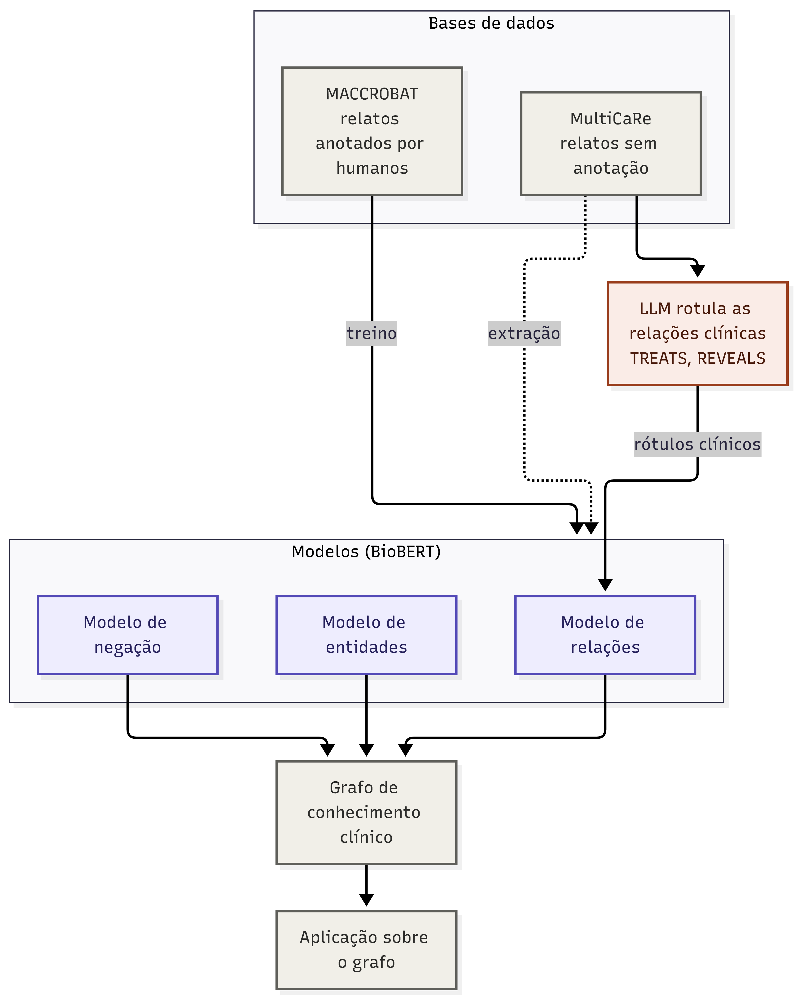

# Projeto 3: plano

## A ideia

Vamos treinar modelos **BioBERT** no **MACCROBAT**, uma base de relatos de caso anotados por humanos. Esses modelos extraem do **MultiCaRe** entidades, negações e relações. Um **LLM** cuida só das relações clínicas que o MACCROBAT não tem: TREATS (tratamento → doença) e REVEALS (exame → achado). Com o resultado, montamos o grafo e construímos uma aplicação em cima dele. No fim, comparamos com o P1 (regras) e o P2 (ML clássico).

## Os três modelos

| Modelo | O que faz | Exemplo |
|---|---|---|
| Entidades | Marca sintomas, doenças, exames, remédios, valores e doses | "hemoglobin of **6 g%**" → exame + valor |
| Negação | Diz se a entidade está presente, negada ou incerta | "no **fever**" → febre negada |
| Relações | Liga entidades da mesma frase | 6 g% → hemoglobin (valor do exame); insulin → diabetes (TREATS) |

O LLM não lê o texto solto. Ele recebe os pares de entidades encontrados pelo modelo de entidades e só diz qual é a relação entre eles.